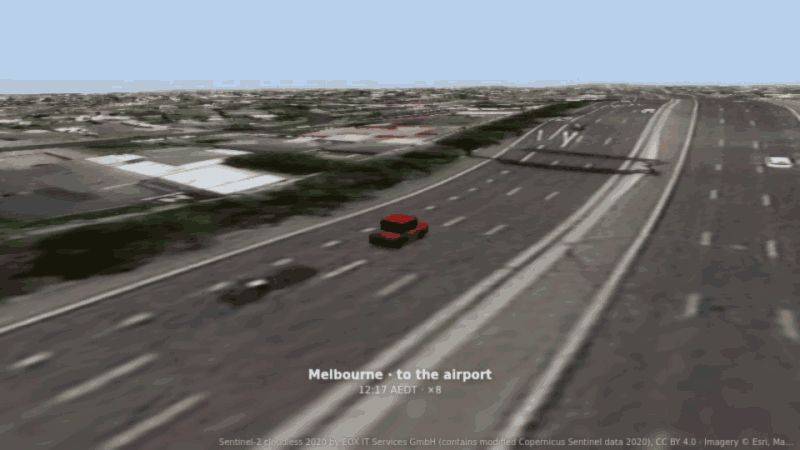
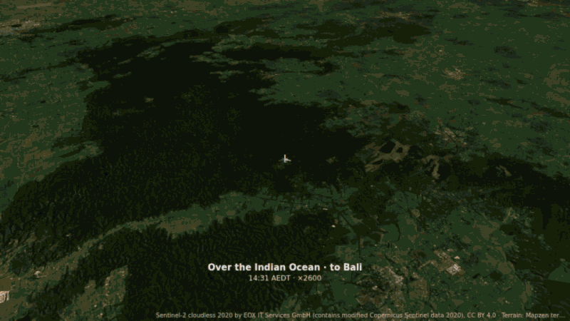
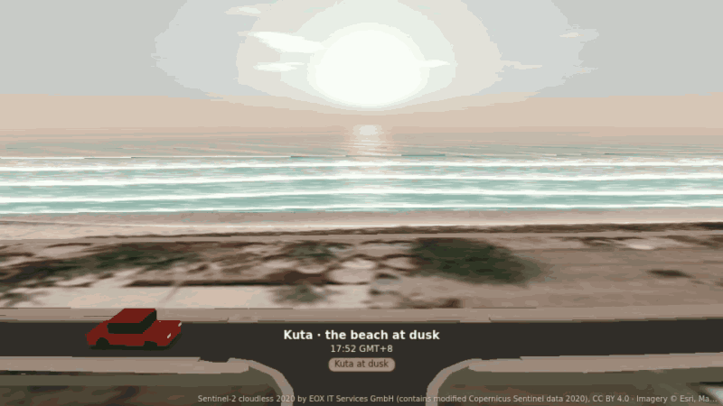
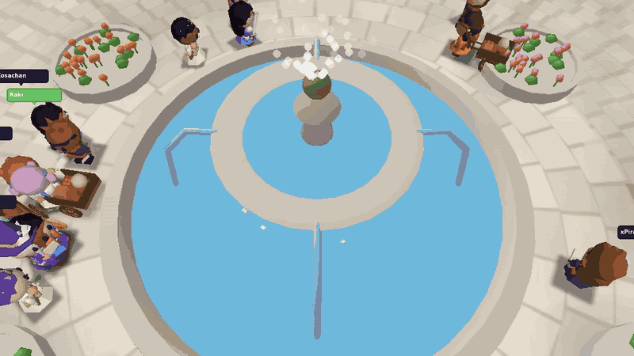
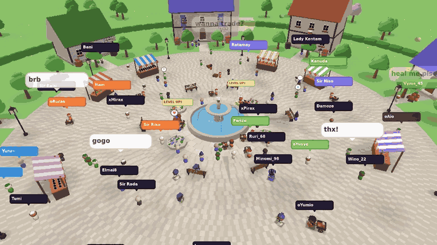
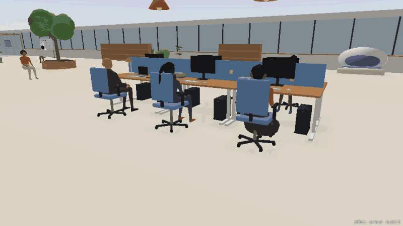
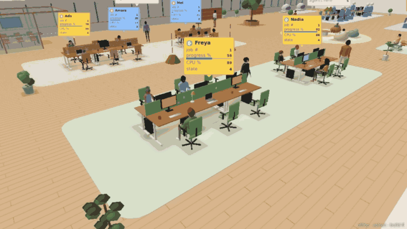

# aslnut

**A world engine for the web: GIS, digital twins and 3D viz on WebGPU and WebGL2.**

_Said "AZ-ul-nut". From Arabic **aṣl** (origin, root) and **nuṭfah** (the seed life begins from): the seed of origin, the small core a whole world grows from._

aslnut makes worlds in the browser. A world is the Earth, from space down to a street, or a flat floor of your own. On it stand roads, buildings, trees and water; on it move cars, people, planes and drones; over it goes your data, as points, lines, areas, extrusions, arcs, trails and labels. The same world runs headless in Node, with the same results.

One chain runs it all: **orbit › observation › data › viz**.

- **Orbit:** the camera only moves the picture. Zoom, tilt and spin never change the data, and never cost a rebuild.
- **Observation:** what you look at decides what is present. A twin is seen through levels (world › country › region › city › district › street › building › room); a level changes past a margin and after a dwell, so nothing flickers at an edge.
- **Data:** each dataset is loaded once and said one way. The same value gives the same look at every zoom.
- **Viz:** the look comes from the feature and your settings only: scales, shaders of your own, and one `when` on everything (by level, time or state).

## Gallery

| | |
|---|---|
|  |  |
| Cars driven by their logs along the city's roads; a chase camera on damped springs. | An airliner takes off: the plane flies its log while the terrain and imagery stream in. |
|  |  |
| From the street to the globe and back, in one continuous world. | The sea and its shore at street level, under the real sun for the place and time. |
|  |  |
| A town square full of animated people, their names and words over them. | Shapes are code: houses, stalls, trees and people built from parameters. |
|  |  |
| An interior twin: an office floor, its people and their status cards. | The camera follows a person; its moves (chase, track, crane, dolly, orbit) are the library's. |

The trip is the `journey` example in `packages/aslnut/examples/`; the town and the office are small apps built on the library.

## Install (from source)

aslnut runs from its source for now; an npm package comes later.

```sh
git clone https://github.com/aslnut/aslnut
cd aslnut
npm install
npm test          # the library's unit tests (no network, no data)
npm run dev       # the examples on port 5190: open /examples/hello-earth/?go=plane
```

Use it in your app by importing the source, `packages/aslnut/src/index.ts`, with any bundler that reads TypeScript. For example, with an alias in Vite:

```ts
// vite.config.ts
import { resolve } from 'node:path';
export default { resolve: { alias: { aslnut: resolve(import.meta.dirname, '../aslnut/packages/aslnut/src/index.ts') } } };
```

Node 24 runs the source as it is, so headless worlds and the tools need no build step.

## A first world

```ts
import { data, earth, imagery, layer, scale, terrain, world } from 'aslnut';

const canvas = document.querySelector('canvas')!;
const w = await world(canvas, {                                                // WebGPU or WebGL2, chosen for you
  body: earth({ imagery: [imagery.sentinel()], terrain: [terrain.mapzen()] }),  // the ground: lists of providers
  view: { lon: 144.96, lat: -37.81, zoom: 11, tilt: 50, bearing: 20 },          // where the camera starts
});
w.add(layer({                                                                  // one dataset, said one way
  id: 'places', data: data.geojson('places.geojson'),                          // loaded once
  points: { size: 10, color: scale.category((d) => String(d.props.kind)) },    // the same kind, the same colour
  labels: { text: (d) => String(d.props.name) },                               // its names, inside the layer
  tooltip: (d) => String(d.props.name),
}));
await w.settled();                                                             // the view complete: tiles, data, builds
```

Next: the **[authoring guide](packages/aslnut/docs/authoring.md)** (one page to write a world, with a complete recipe per kind of app) and **[llms.txt](packages/aslnut/docs/llms.txt)** (the guide, the recipes, every import and every signature in one file, for assistants). Wrapping aslnut into a platform of your own (a component library, a flow runtime, a server)? Read the **[implementers' guide](packages/aslnut/docs/implementers.md)**. The design, idea by idea, starts at [packages/aslnut/docs](packages/aslnut/docs/README.md).

## WebGPU and WebGL2

Both are first class. Every feature, example and check runs on both from the first day, and the checks compare the same frame on both, pixel by pixel. `graphics: 'auto'` (the default) tries WebGPU, then WebGL2, and says why it chose; `'webgpu'` or `'webgl2'` asks for one and fails plainly when it is missing. Your own shaders are written once, in a WGSL subset, and translated for WebGL2. Phones come first: budgets, a governor, streaming and memory limits keep a world smooth on a mid-range phone.

## What is here

```
packages/aslnut/   the library: src/, its examples, tools, tests and docs
packages/server/   the reference host for aslnut's formats: serve or bake mesh tiles and their archives, with live edits
packages/baker/    the road baker (Rust): open road data in, baked road packs out
STATUS.md          every part of aslnut and its status, generated from packages/aslnut/docs/_tree/spec.txt
CHANGELOG.md       what each version is
```

Large data (imagery packs, terrain, baked roads) is never in git. Examples that show real places read their packs from a `data/` folder at the repo root; the tools in `packages/aslnut/tools/` (`demo-data*.mjs`, `journey-data.mjs` and others) make them from open data you download. To see those examples, build them (`npm run examples`) and serve them with `node packages/aslnut/tools/serve.mjs`, which serves `data/` beside them.

## Credits for the data shown

- Imagery from space: Sentinel-2 cloudless 2020 by EOX IT Services GmbH (contains modified Copernicus Sentinel data 2020), CC BY 4.0.
- Imagery up close: © Esri, Maxar, Earthstar Geographics.
- Terrain: Mapzen terrain tiles (AWS Open Data), from several open sources, each with its own attribution.
- Roads, buildings and trees: © OpenStreetMap contributors (ODbL).
- The town square and the office are made of aslnut's own shapes, with no outside data.

Every world shows its credits on screen, and the loader keeps each service's terms: see [DATA-LICENCES.md](packages/aslnut/DATA-LICENCES.md).

## Licence

Apache-2.0: see [LICENSE](LICENSE) and [NOTICE](NOTICE). The repository holds code only; the data services aslnut can use have their own terms.
